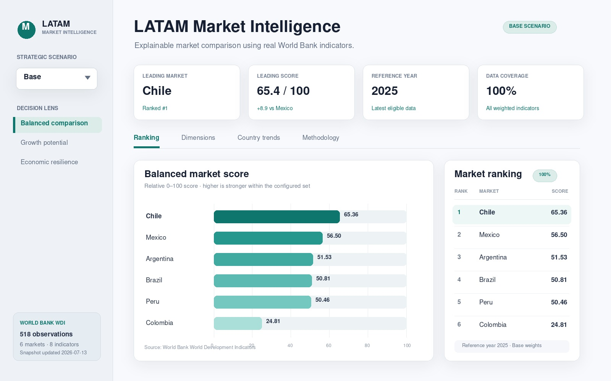
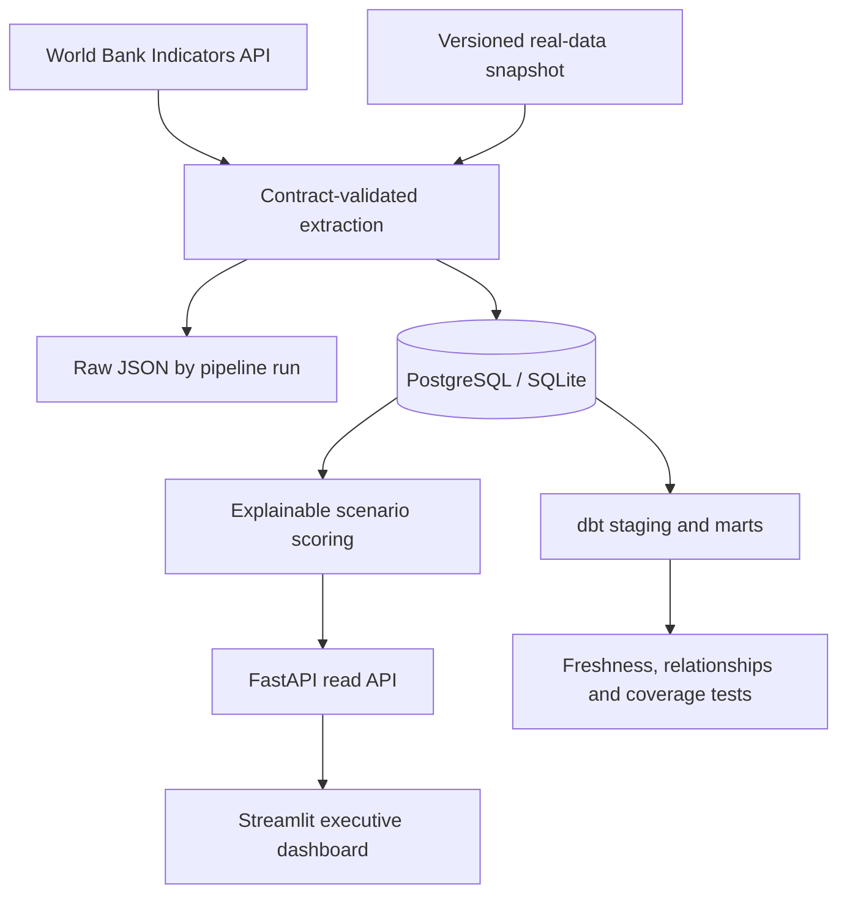

# LATAM Market Intelligence

[](https://github.com/TheKhadaJhin/latam-market-intelligence/actions/workflows/ci.yml)
[](https://github.com/TheKhadaJhin/latam-market-intelligence/actions/workflows/security.yml)
[](https://www.python.org/)
[](https://fastapi.tiangolo.com/)
[](https://www.getdbt.com/)
[](LICENSE)

An end-to-end data product that compares six Latin American markets using reproducible
World Bank indicators, transparent scoring scenarios, a tested API, and an executive
dashboard.

The project demonstrates how raw public data becomes a decision-ready product through
contract validation, idempotent loading, analytical modeling, data-quality controls,
explainable scoring, observability, and clear communication.

> This is a portfolio decision-support model—not investment, legal, economic, or expansion
> advice. Scores are relative to the configured countries, indicators, year, and scenario.

## Executive dashboard



The preview uses the committed World Bank snapshot and the reproducible base-scenario
scores documented below.

## Business question

**Which configured LATAM markets show the strongest relative conditions for expansion, and
what measurable factors explain the result?**

The model compares Argentina, Brazil, Chile, Colombia, Mexico, and Peru across:

- economic growth and market scale;
- price and labor-market stability;
- digital adoption and urban access;
- trade connectivity.

It exposes three deliberately different views:

| Scenario | Decision lens |
| --- | --- |
| `base` | Balanced comparison across all eight indicators |
| `growth` | Growth, digital adoption, and trade connectivity |
| `resilience` | Inflation, unemployment, income, and economic stability |

## Reproducible result at a glance

The same committed World Bank snapshot produces all three scenario rankings below.
The source reports its latest dataset update as **2026-07-13**; the scoring reference year is
**2025** and all six markets have **100% weighted coverage** in each scenario.
Rank columns show positions, where **1 is the highest-ranked market**; the score column
belongs to `base` only.

| Market | `base` rank | Balanced score | `growth` rank | `resilience` rank |
| --- | ---: | ---: | ---: | ---: |
| Chile | 1 | 65.36 | 1 | 2 |
| Mexico | 2 | 56.50 | 4 | 1 |
| Argentina | 3 | 51.53 | 2 | 5 |
| Brazil | 4 | 50.81 | 5 | 3 |
| Peru | 5 | 50.46 | 3 | 4 |
| Colombia | 6 | 24.81 | 6 | 6 |

Chile leads `base` and `growth`, Mexico leads `resilience`, and Argentina moves from
second in `growth` to fifth in `resilience`.
With the data and reference year held constant, these changes show sensitivity to the
[configured scenario weights](src/market_intel/catalog.py): they are analyst assumptions,
not learned parameters or a forecast of which country will perform best.

### Reproduce the scenario comparison

Use a fresh checkout without an existing SQLite database or `.env` overrides, so previous
live observations cannot enter this snapshot-only comparison. From the repository root:

```bash
uv sync --frozen --no-dev
uv run --frozen --no-dev market-intel pipeline --snapshot data/sample/world_bank_snapshot.json --start-year 2015 --end-year 2026
uv run --frozen --no-dev market-intel export-rankings --scenario base --year 2025 --destination data/exports/rankings_base.csv
uv run --frozen --no-dev market-intel export-rankings --scenario growth --year 2025 --destination data/exports/rankings_growth.csv
uv run --frozen --no-dev market-intel export-rankings --scenario resilience --year 2025 --destination data/exports/rankings_resilience.csv
```

The pipeline reports **518 observations**, **18 rankings** and reference year **2025**.
Each CSV contains six markets, including their position, score and coverage. The `base`
export matches the committed [expected ranking](data/sample/expected_rankings_base.csv);
the other two exports reproduce the additional columns above.

These commands use the existing [pipeline](src/market_intel/services/pipeline.py) and
[CSV exporter](src/market_intel/cli.py). They do not fetch live World Bank data or change
the scoring rules. Generated exports stay in the ignored `data/exports/` directory.

## Architecture



## What the project demonstrates

- **Data engineering:** typed source contracts, bounded concurrency, retries, timeouts,
  raw-data lineage, idempotent upserts, run audit records, and offline replay.
- **Analytics engineering:** dbt sources, staging views, fact/mart models, freshness checks,
  relationships, uniqueness, and coverage tests.
- **Analytical reasoning:** explicit indicator polarity, scenario weights, robust
  normalization, staleness rules, missing-data controls, and transparent limitations.
- **Backend engineering:** FastAPI, SQLAlchemy 2, PostgreSQL/SQLite portability, Alembic,
  OpenAPI, health/readiness probes, Prometheus metrics, and structured logs.
- **Delivery:** locked dependencies, non-root containers, Docker Compose, CI, CodeQL,
  dependency scanning, tests, runbooks, ADRs, and reproducible sample data.

## Quick start: zero external services

Requirements: Python 3.12 and [`uv`](https://docs.astral.sh/uv/).

```bash
git clone https://github.com/TheKhadaJhin/latam-market-intelligence.git
cd latam-market-intelligence
uv sync --group dev

# Load the committed snapshot of real World Bank data into SQLite.
uv run market-intel pipeline \
  --snapshot data/sample/world_bank_snapshot.json \
  --start-year 2015 \
  --end-year 2026

uv run uvicorn market_intel.main:app --reload
```

Open:

- API documentation: <http://localhost:8000/docs>
- Rankings: <http://localhost:8000/v1/rankings>
- Prometheus metrics: <http://localhost:8000/metrics>

Run the dashboard in another terminal:

```bash
uv run --extra dashboard streamlit run dashboard/app.py
```

Dashboard: <http://localhost:8501>

## Live pipeline

The World Bank Indicators API requires no API key.

```bash
uv run market-intel pipeline --start-year 2015 --end-year 2026
uv run market-intel export-rankings --scenario base
```

Every live run stores its upstream payloads under `data/raw/<run-id>/` for auditability.
Generated raw data and exports are ignored by Git; the curated snapshot is intentionally
versioned.

## PostgreSQL and containers

```bash
cp .env.example .env
docker compose up -d db api
docker compose --profile pipeline run --rm pipeline
docker compose up -d dashboard
```

Services:

| Service | Port | Purpose |
| --- | ---: | --- |
| `db` | 5432 | PostgreSQL persistence |
| `api` | 8000 | Read-only ranking and history API |
| `dashboard` | 8501 | Executive comparison interface |
| `pipeline` | — | One-shot extraction and score materialization |

## API

| Method | Path | Purpose |
| --- | --- | --- |
| `GET` | `/health` | Liveness and service version |
| `GET` | `/ready` | Database, data availability, and last successful run |
| `GET` | `/metrics` | Prometheus metrics |
| `GET` | `/v1/countries` | Configured comparison markets |
| `GET` | `/v1/indicators` | Indicator definitions and base weights |
| `GET` | `/v1/rankings?scenario=base` | Ranked, explainable market scores |
| `GET` | `/v1/countries/{code}/history` | Indicator history by market |
| `GET` | `/v1/pipeline-runs` | Pipeline audit trail |
| `GET` | `/v1/methodology` | Machine-readable scoring rules and disclaimer |

Example:

```bash
curl "http://localhost:8000/v1/rankings?scenario=growth"
curl "http://localhost:8000/v1/countries/CHL/history?indicator=IT.NET.USER.ZS"
```

## Scoring methodology

1. Select the most recent value at or before the reference year.
2. Reject values older than the configured three-year staleness window.
3. Clip each indicator at the cross-country 10th and 90th percentiles.
4. Normalize the values to a relative `0–100` scale.
5. Reverse indicators where lower is preferable, such as inflation.
6. Apply the selected scenario weights.
7. Require at least 75% weighted coverage and report the exact coverage ratio.
8. Apply a small, documented coverage penalty before ranking.

The score is deliberately **explainable and relative**. It is not a forecast, causal model,
or universal statement about a country. See [Methodology](docs/METHODOLOGY.md).

## Data source and attribution

The snapshot and live pipeline use the [World Bank World Development Indicators API](https://api.worldbank.org/v2).
World Bank open datasets are generally provided under CC BY 4.0 with additional dataset
terms. Attribution: **The World Bank, World Development Indicators**. See
[DATA_SOURCES.md](docs/DATA_SOURCES.md) before redistributing data.

## Quality checks

```bash
make check
```

This runs formatting, linting, strict type checking, unit/integration/API tests with a 90%
coverage gate, Bandit, and dependency auditing. CI repeats these checks on every push and
pull request.

For dbt against PostgreSQL:

```bash
cp warehouse/dbt/profiles.yml.example warehouse/dbt/profiles.yml
cd warehouse/dbt
uv run --extra warehouse dbt build --profiles-dir .
```

## Repository structure

```text
src/market_intel/       Core domain, ingestion, scoring, repository, API and CLI
dashboard/              Streamlit executive dashboard
warehouse/dbt/          Sources, staging models, marts and data-quality tests
migrations/             Alembic database migrations
data/sample/            Versioned snapshot of real public data
scripts/                Reproducibility and operational scripts
tests/                  Unit, integration, contract and API tests
docs/                   Architecture, methodology, dictionary, runbook and ADRs
.github/                 CI, security, release and contribution automation
```

## Known limitations

- Annual macro indicators have publication delays and may be revised by the source.
- A six-market relative score changes when countries, indicators, weights, or years change.
- Country-level macro data does not capture local regulations, unit economics, customer
  behavior, competition, or execution risk.
- Missing values use recent observations only within a documented window; they are never
  silently imputed with averages.
- Scenario weights are analyst assumptions, not learned parameters.

## Documentation

- [Architecture](docs/ARCHITECTURE.md)
- [Methodology and limitations](docs/METHODOLOGY.md)
- [Data dictionary](docs/DATA_DICTIONARY.md)
- [Data sources and licensing](docs/DATA_SOURCES.md)
- [Deployment guide](docs/DEPLOYMENT.md)
- [Operational runbook](docs/RUNBOOK.md)
- [Interview explanation in Spanish](docs/INTERVIEW_GUIDE_ES.md)
- [Architecture decision records](docs/adr/)

## Author

**Mario Fuentes** — [TheKhadaJhin](https://github.com/TheKhadaJhin)
