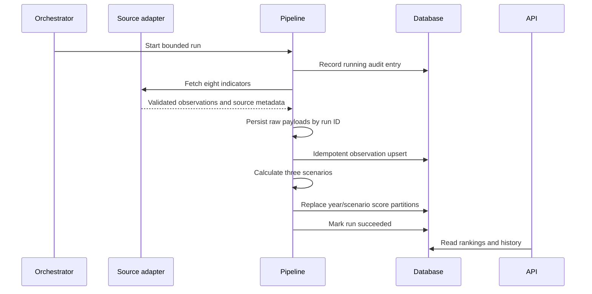

# Architecture

## Goals

The system turns a small, auditable set of public macro indicators into a reproducible market
comparison. It prioritizes traceability and explanation over model complexity.

## Components

| Component | Responsibility | Failure boundary |
| --- | --- | --- |
| World Bank adapter | Fetch and validate documented API responses | Timeout, HTTP error, contract drift |
| Snapshot adapter | Replay a committed real-data snapshot | Invalid or incomplete snapshot |
| Pipeline service | Coordinate extraction, raw lineage, upsert, and scoring | Run recorded as failed |
| Repository | Persist catalog, observations, scores, and run audit | Transaction rollback |
| Scoring service | Normalize, weight, penalize sparse coverage, and rank | Pure deterministic function |
| dbt project | Build business-ready analytical marts and quality tests | Warehouse job failure |
| FastAPI | Expose read-only rankings, history, runs, and methodology | Independent process |
| Streamlit | Present executive comparisons through the API | No direct database access |

## Data flow

## Portability

The domain, source, scoring, and repository layers do not depend on FastAPI, Streamlit, or
Prefect. SQLite supports zero-service evaluation and tests. PostgreSQL is the production
target and the source for dbt models.

## Reliability

- Network calls use explicit timeouts, exponential retry, and bounded concurrency.
- A failed run is recorded without deleting the previous successful scores.
- Observation keys make replay and backfill idempotent.
- Score replacement is partitioned by year and scenario.
- Raw payloads provide run-level lineage outside the normalized database.
- Readiness requires both database access and loaded observations.

## Security boundary

The public API is read-only. Pipeline mutations occur through the CLI/orchestrator, separate
from HTTP request handling. Production API documentation is disabled, containers run as a
non-root user, CORS is explicit, and security headers are added to every response.
